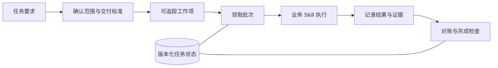

# 行政智能助手 · 公开作品集

面向行政材料与多步骤业务任务的智能助手，由作者主导需求分析、系统设计、开发和集成。本仓库公开可独立运行的通用工程组件，展示任务拆分、状态管理与执行约束的实现；机构系统适配、认证逻辑与业务资料保持私有。

## 产品解决的问题

行政任务通常同时涉及材料理解、来源核对、内容生产、审核与交付。系统将这些职责拆分为业务 Skills，并通过编排层记录工作项、批次、状态与完成证据，减少“对话结束但任务未完成”的情况。

完整系统由业务 Skills、MCP 接口、任务编排框架和状态服务组成。作者实现了业务层与集成逻辑；外部大模型、Agent 宿主及第三方依赖不计为自研成果。公开仓库不是全部生产系统，也不包含机构内部账号或接口。

## 公开代码

| 组件 | 入口 | 可审阅内容 |
| --- | --- | --- |
| 长任务编排 | [Skill](skills/long-task-orchestrator/SKILL.md) | 初始化、工作项枚举、批次领取、状态更新、恢复与对账 |
| 状态存储 | [task_state_store.py](core/adapters/task_state_store.py) | SQLite 存储、版本校验、冲突显式返回、迁移历史 |
| 命令副作用分类 | [side_effect_classifier.py](core/policies/side_effect_classifier.py) | 读取、本地写入、网络访问、外部副作用与未知类别 |
| 状态契约 | [schema](core/protocols/task_state_v1.schema.json) | 结构化状态字段与约束 |



## 本地体验

只需要 Python 3.10+，以下演示不调用网络或机构系统，只创建一个全新的本地演示目录：

```bash
python examples/demo.py
```

演示检查两类行为：SQLite 中过期版本写入被拒绝；代表性命令被分类为读取、本地写入、网络访问或外部副作用。分类器只分析字符串，绝不会执行这些命令。

长任务脚本可通过 `python skills/long-task-orchestrator/scripts/<脚本>.py` 查看各自用法。`examples/synthetic_contract.json` 提供纯合成任务输入。

## 能力与适用边界

- 展示系统分层、结构化协议、任务状态管理和可追溯执行能力。
- `SqliteStore` 用事务和版本检查保护更新；`LocalJsonStore` 是早期本地实现，不应据此宣称并发安全。
- 长任务批次领取脚本明确要求调用方保证同一任务包由单个进程领取；目前不提供跨进程文件锁。
- 命令分类是启发式控制的一层，不能作为独立安全沙箱或完整 Shell 解析器。
- 本仓库的合成演示不代表真实行政系统的端到端验收或效率测量。

`SOURCE_MANIFEST.json` 记录精选原组件的哈希。没有上传真实业务输入、用户记录、运行日志或历史数据库。查看源码不意味着获得额外的开放源码许可授权。
